# Sinnes Automobiles

## Ma réalisation la plus approfondie

J'ai consacré plus de trois mois à ce projet, avec un investissement quotidien très important. Ce travail a porté sur la conception du site, le référencement naturel (SEO), l'étude du secteur et des concurrents, et l'amélioration de la présentation sur ordinateur et téléphone.

Ce site est ma première réalisation centrale et reste la plus approfondie de mon parcours. Mon projet d'activité principal est désormais [Ancrage / Website Factory](https://github.com/cpointis96-hue/business-site-factory#readme), qui reprend cette direction de travail autour des sites et de la visibilité d'entreprises locales.

Le site présente une activité de serrurerie automobile à Nice. Il permet de comprendre les services, de trouver une réponse à une situation concrète (clé perdue, double de clé, programmation) et de rejoindre les moyens de contact.

## Vue d’ensemble du travail : SEO, marché et offres commerciales

Cette réalisation regroupe le développement d’un site et une réflexion complète sur la manière de rendre une prestation visible, compréhensible et vendable à une entreprise locale. Les éléments ci-dessous résument le travail dès la page d’accueil du dépôt ; les documents liés donnent les détails et les pièces originales.

### Analyse SEO et organisation du site

J’ai analysé l’ancien site WordPress et préparé une refonte sur mesure autour des besoins des automobilistes : reproduction ou perte de clé, programmation, urgence, déplacement, tarifs et marques de véhicules. Le travail comprend une architecture de pages par intention de recherche, des contenus locaux autour de Nice et des communes voisines, une stratégie de liens entre pages, ainsi que les éléments techniques de référencement tels que les titres, descriptions, données structurées, sitemap et consignes d’exploration.

Cette démarche vise à mieux répondre aux recherches des clients et à faciliter la compréhension du site par les moteurs de recherche. Elle ne prouve pas un gain de trafic ou de positionnement. Les volumes de recherche, scores et comparaisons figurant dans les documents sont des données historiques qui n’ont pas toutes été revérifiées.

### Étude de la concurrence et du marché

J’ai recensé des acteurs locaux de la serrurerie automobile et comparé les besoins auxquels leurs sites répondent : services, recherches par marque, urgence, prix, zone d’intervention et contact. Les pistes de développement incluent les agences de location, les assurances et les annuaires locaux. J’ai également recherché des repères de prix pour la création de sites, les audits SEO, la maintenance et le suivi mensuel.

Ces recherches ont servi à construire le projet et à réfléchir au positionnement. Elles constituent un repérage préparatoire, pas une étude complète des parts de marché ni une validation actuelle des tarifs de chaque concurrent.

### Offres et tarification proposées

J’ai structuré le travail commercial en deux prestations indépendantes, avec un périmètre et un prix lisibles :

| Formule | Prix proposé | Périmètre |
|---|---:|---|
| Création du site | 7 000 € HT | Conception, développement, pages et contenus définis au devis, réglages SEO techniques de base et remise du code source après règlement. |
| Suivi SEO local et entretien | 800 € HT/mois | Une optimisation éditoriale par mois, entretien courant, suivi des requêtes convenues, observation de trois concurrents, compte rendu et échange mensuel. |

La TVA et le total à payer seront précisés sur le devis selon le régime applicable au prestataire. Le suivi mensuel est une prestation de moyens : aucun classement Google ni résultat commercial n’est garanti. Les deux formules, leurs limites et les documents associés sont détaillés dans le [dossier de tarification](docs/dossier-professionnel/tarification.md).

### Présentation et cadre de prestation

J’ai préparé une présentation commerciale qui explique le site, sa valeur et les deux façons de travailler ensemble, ainsi qu’un contrat de prestation associé. Le contrat précise les prestations, le paiement, la livraison, les droits sur les créations, la maintenance et les limites du référencement.

Ces documents montrent un travail de préparation commerciale et contractuelle. Ils ne prouvent ni signature, ni vente, ni suivi mensuel effectivement réalisé. La [proposition commerciale](docs/dossier-professionnel/pieces/offre-commerciale.md) et le [contrat de prestation](docs/dossier-professionnel/pieces/contrat-prestation-sinnes.md) sont accessibles dans le [dossier professionnel](docs/dossier-professionnel/README.md). La [présentation commerciale PDF](docs/dossier-professionnel/pieces/presentation-commerciale.pdf), l’offre détaillée et le contrat sont disponibles au téléchargement.

### Lire les pièces détaillées

- [Présentation commerciale](docs/dossier-professionnel/pieces/presentation-commerciale.md)
- [Présentation du travail et compétences mobilisées](docs/dossier-professionnel/presentation.md)
- [Tarification et périmètre des offres](docs/dossier-professionnel/tarification.md)
- [Concurrence et étude de marché](docs/dossier-professionnel/marche-et-concurrence.md)
- [Contrat de prestation et conditions](docs/dossier-professionnel/contrat.md)
- [Inventaire des documents et provenance](docs/dossier-professionnel/inventaire.md)

## Voir le site sur son ordinateur

Le site n'est pas hébergé pour cette présentation. Les captures ci-dessous permettent de le découvrir directement, sans installation.

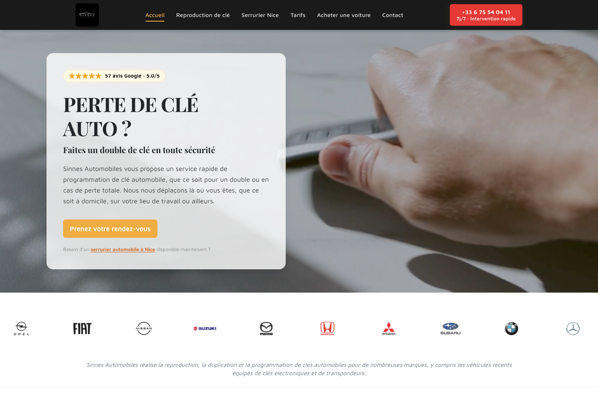

Pour ouvrir le site et naviguer entre ses pages, il faut télécharger le projet et le lancer sur son ordinateur. Télécharger seulement le ZIP ne suffit pas à l'ouvrir comme un document.

1. Installer Node.js depuis [son site officiel](https://nodejs.org/), en choisissant la version LTS. Fermer puis rouvrir le terminal après l'installation.
2. [Télécharger le dossier du site](https://github.com/cpointis96-hue/sinnes-nextjs/archive/HEAD.zip), puis extraire le ZIP.
3. Sur Windows : double-cliquer sur `ouvrir-le-site.bat`. Sur Mac : utiliser `ouvrir-le-site.command` (voir la précision ci-dessous).
4. Au premier lancement, laisser le programme télécharger les composants et préparer le site. Internet est nécessaire ; cela peut prendre plusieurs minutes. Les fichiers sont installés dans le dossier téléchargé.
5. Le navigateur s'ouvre sur le site. Garder la fenêtre de lancement ouverte pendant la visite. Pour arrêter, revenir dans cette fenêtre et appuyer sur Ctrl+C.

Si le navigateur ne s'ouvre pas, saisir `http://127.0.0.1:4187` dans sa barre d'adresse.

Sur Mac, le ZIP GitHub peut ne pas conserver l'autorisation d'exécuter le fichier. Dans ce cas : ouvrir Terminal, taper `sh` suivi d'un espace, glisser `ouvrir-le-site.command` dans la fenêtre, puis appuyer sur Entrée. Si un ordinateur professionnel interdit l'installation de programmes, consulter les captures ou demander une aide informatique.

Le lanceur démarre une version locale de démonstration. Les captures peuvent être regardées sans installer Node.js ni exécuter de fichier. Les étapes Windows sont préparées mais doivent encore être testées sur Windows.

## Parcourir les 23 pages en captures pleine longueur

Chaque aperçu montre la page entière à petite largeur. Faites défiler le README pour parcourir les pages ; cliquez sur une capture pour ouvrir l’image complète et la lire plus confortablement.

<table><tbody>
<tr><td align="center" valign="top"><a href="docs/captures-pages/accueil.jpg">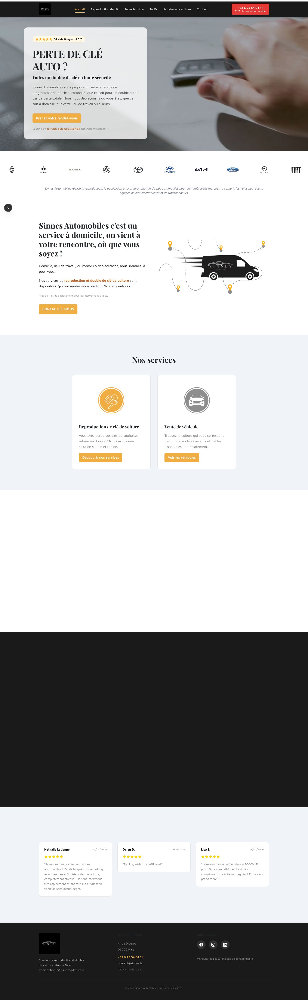</a><br><strong>Sinnes Automobiles — Reproduction de clé voiture Nice</strong><br><a href="docs/captures-pages/accueil.jpg">Ouvrir la capture complète</a></td><td align="center" valign="top"><a href="docs/captures-pages/acheter-une-voiture.jpg">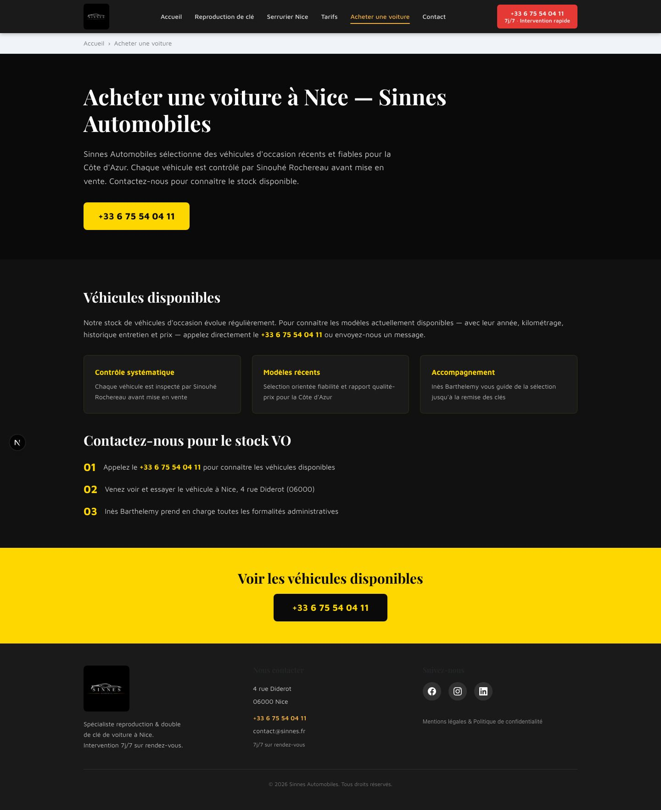</a><br><strong>Acheter une voiture à Nice — Sinnes Automobiles | Sinnes Nice</strong><br><a href="docs/captures-pages/acheter-une-voiture.jpg">Ouvrir la capture complète</a></td><td align="center" valign="top"><a href="docs/captures-pages/cle-voiture-nice.jpg">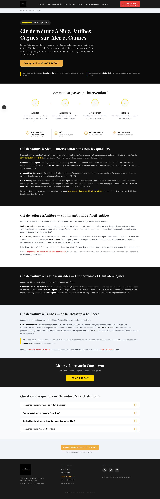</a><br><strong>Clé de voiture Nice, Antibes, Cagnes-sur-Mer, Cannes | Sinnes Nice</strong><br><a href="docs/captures-pages/cle-voiture-nice.jpg">Ouvrir la capture complète</a></td></tr>

<tr><td align="center" valign="top"><a href="docs/captures-pages/cle-voiture-perdue.jpg">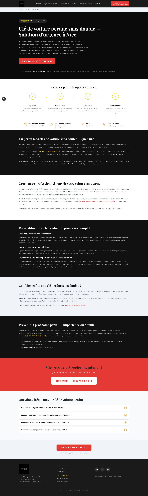</a><br><strong>Clé de voiture perdue sans double — Solution Nice | Sinnes Nice</strong><br><a href="docs/captures-pages/cle-voiture-perdue.jpg">Ouvrir la capture complète</a></td><td align="center" valign="top"><a href="docs/captures-pages/cle-voiture-transpondeur.jpg">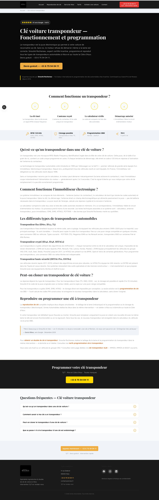</a><br><strong>Clé voiture transpondeur — Fonctionnement et programmation | Sinnes Nice</strong><br><a href="docs/captures-pages/cle-voiture-transpondeur.jpg">Ouvrir la capture complète</a></td><td align="center" valign="top"><a href="docs/captures-pages/contactez-nous.jpg">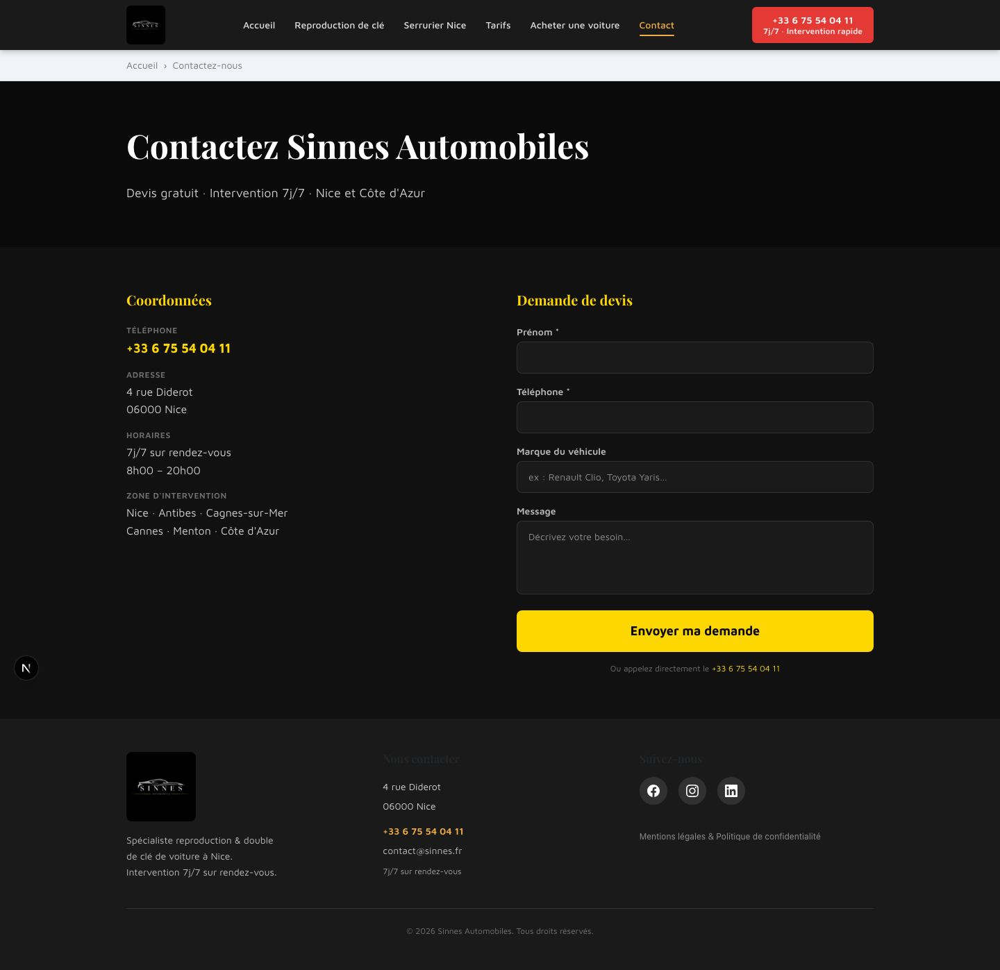</a><br><strong>Sinnes Automobiles — Reproduction de clé voiture Nice</strong><br><a href="docs/captures-pages/contactez-nous.jpg">Ouvrir la capture complète</a></td></tr>

<tr><td align="center" valign="top"><a href="docs/captures-pages/depannage-cle-domicile.jpg">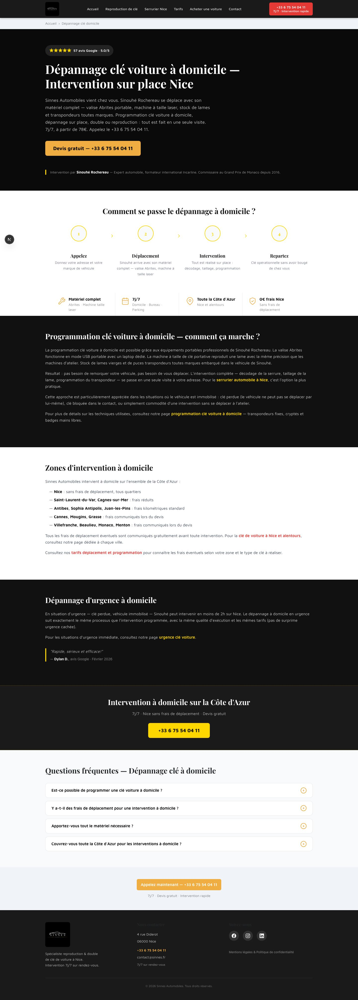</a><br><strong>Dépannage clé voiture à domicile — Nice et Côte d&#x27;Azur | Sinnes Nice</strong><br><a href="docs/captures-pages/depannage-cle-domicile.jpg">Ouvrir la capture complète</a></td><td align="center" valign="top"><a href="docs/captures-pages/double-cle-voiture.jpg">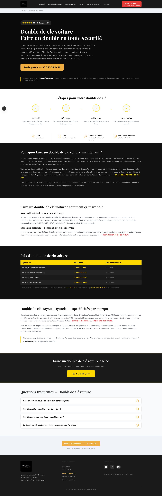</a><br><strong>Double de clé voiture à Nice — Devis gratuit | Sinnes Nice</strong><br><a href="docs/captures-pages/double-cle-voiture.jpg">Ouvrir la capture complète</a></td><td align="center" valign="top"><a href="docs/captures-pages/mentions-legales-et-politique-de-confidentialite.jpg">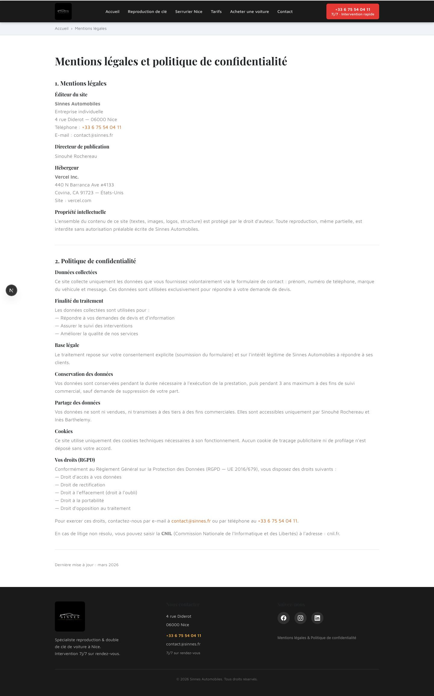</a><br><strong>Mentions légales et politique de confidentialité — Sinnes Automobiles | Sinnes Nice</strong><br><a href="docs/captures-pages/mentions-legales-et-politique-de-confidentialite.jpg">Ouvrir la capture complète</a></td></tr>

<tr><td align="center" valign="top"><a href="docs/captures-pages/prix-cle-voiture.jpg">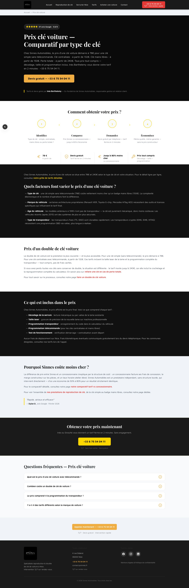</a><br><strong>Prix clé voiture — Facteurs et fourchettes | Sinnes Nice | Sinnes Nice</strong><br><a href="docs/captures-pages/prix-cle-voiture.jpg">Ouvrir la capture complète</a></td><td align="center" valign="top"><a href="docs/captures-pages/prix-cle-vs-concessionnaire.jpg">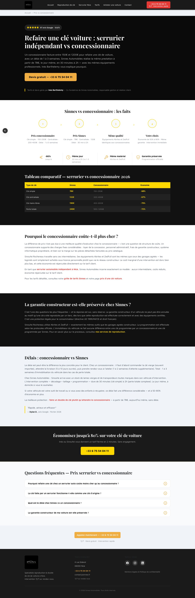</a><br><strong>Serrurier auto vs concessionnaire — Jusqu&#x27;à 80% moins cher | Sinnes Nice</strong><br><a href="docs/captures-pages/prix-cle-vs-concessionnaire.jpg">Ouvrir la capture complète</a></td><td align="center" valign="top"><a href="docs/captures-pages/programmation-cle-voiture.jpg">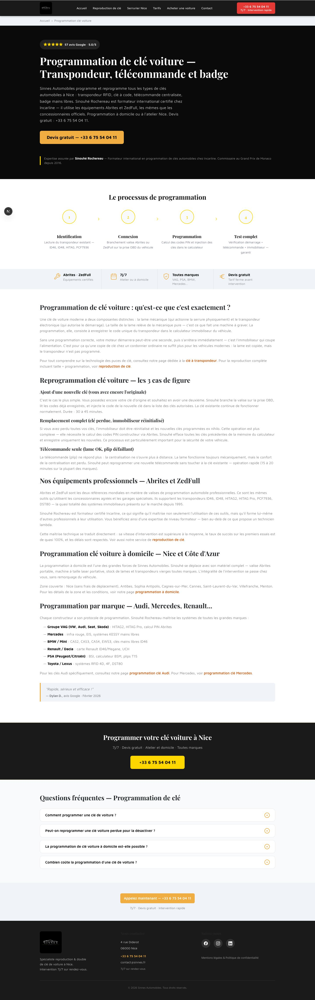</a><br><strong>Programmation de clé voiture Nice — Transpondeur et badge | Sinnes Nice</strong><br><a href="docs/captures-pages/programmation-cle-voiture.jpg">Ouvrir la capture complète</a></td></tr>

<tr><td align="center" valign="top"><a href="docs/captures-pages/qui-sommes-nous.jpg">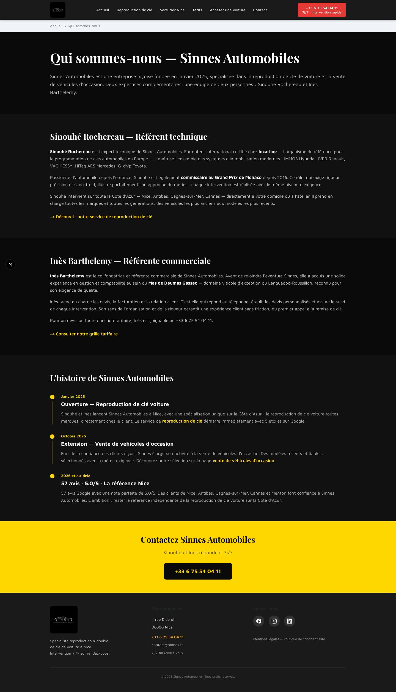</a><br><strong>Qui sommes-nous — Sinnes Automobiles Nice | Sinnes Nice</strong><br><a href="docs/captures-pages/qui-sommes-nous.jpg">Ouvrir la capture complète</a></td><td align="center" valign="top"><a href="docs/captures-pages/refaire-cle-audi.jpg">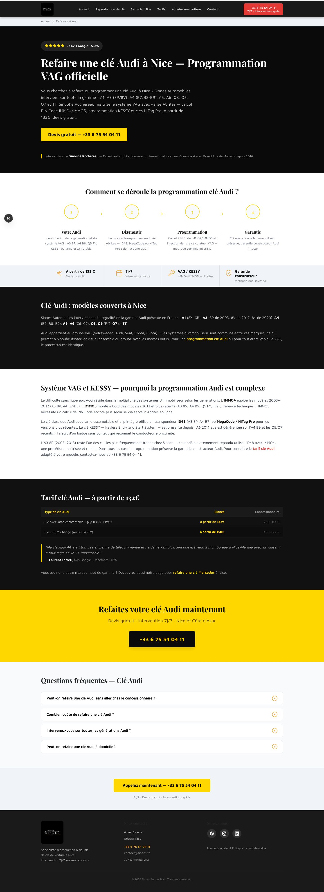</a><br><strong>Refaire une clé Audi à Nice — Programmation VAG officielle | Sinnes Nice</strong><br><a href="docs/captures-pages/refaire-cle-audi.jpg">Ouvrir la capture complète</a></td><td align="center" valign="top"><a href="docs/captures-pages/refaire-cle-fiat.jpg">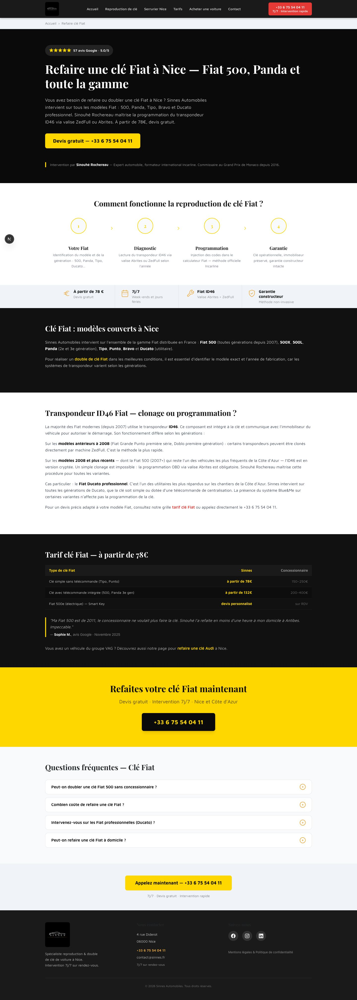</a><br><strong>Refaire une clé Fiat 500 à Nice — Double et programmation | Sinnes Nice</strong><br><a href="docs/captures-pages/refaire-cle-fiat.jpg">Ouvrir la capture complète</a></td></tr>

<tr><td align="center" valign="top"><a href="docs/captures-pages/refaire-cle-hyundai.jpg">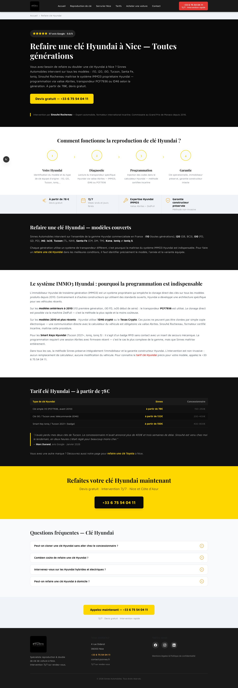</a><br><strong>Refaire une clé Hyundai à Nice — Toutes générations | Sinnes Nice</strong><br><a href="docs/captures-pages/refaire-cle-hyundai.jpg">Ouvrir la capture complète</a></td><td align="center" valign="top"><a href="docs/captures-pages/refaire-cle-mercedes.jpg">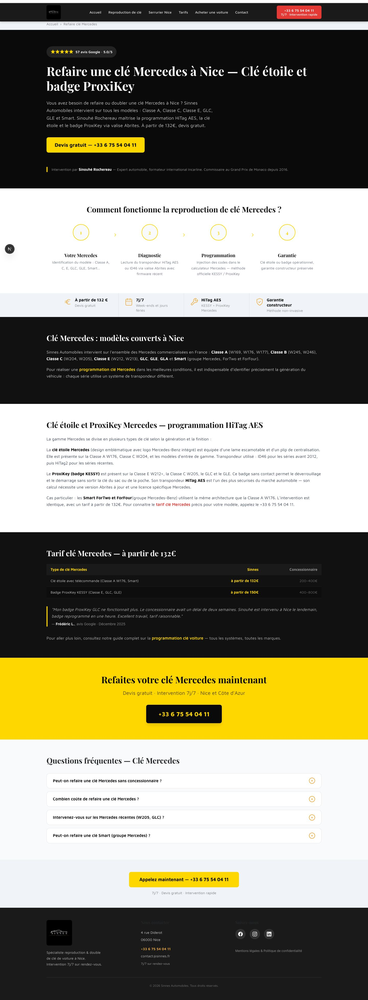</a><br><strong>Refaire une clé Mercedes à Nice — Clé étoile et badge | Sinnes Nice</strong><br><a href="docs/captures-pages/refaire-cle-mercedes.jpg">Ouvrir la capture complète</a></td><td align="center" valign="top"><a href="docs/captures-pages/refaire-cle-renault.jpg"></a><br><strong>Refaire une clé Renault à Nice — Clé carte et clé à lame | Sinnes Nice</strong><br><a href="docs/captures-pages/refaire-cle-renault.jpg">Ouvrir la capture complète</a></td></tr>

<tr><td align="center" valign="top"><a href="docs/captures-pages/refaire-cle-toyota.jpg"></a><br><strong>Refaire une clé Toyota à Nice — Hybride et thermique | Sinnes Nice</strong><br><a href="docs/captures-pages/refaire-cle-toyota.jpg">Ouvrir la capture complète</a></td><td align="center" valign="top"><a href="docs/captures-pages/reproduction-cle-voiture.jpg">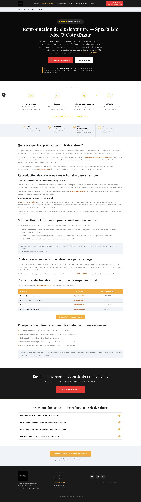</a><br><strong>Reproduction de clé de voiture Nice — Spécialiste | Sinnes Nice</strong><br><a href="docs/captures-pages/reproduction-cle-voiture.jpg">Ouvrir la capture complète</a></td><td align="center" valign="top"><a href="docs/captures-pages/serrurier-automobile-nice.jpg">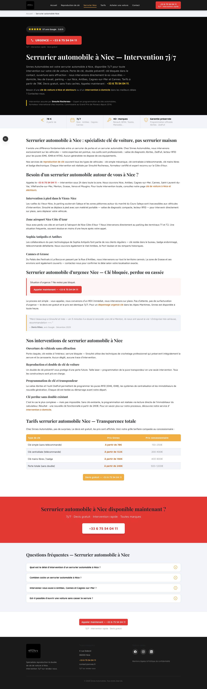</a><br><strong>Serrurier Automobile Nice — Intervention 7j/7 | Sinnes Nice</strong><br><a href="docs/captures-pages/serrurier-automobile-nice.jpg">Ouvrir la capture complète</a></td></tr>

<tr><td align="center" valign="top"><a href="docs/captures-pages/tarif-cle-voiture.jpg">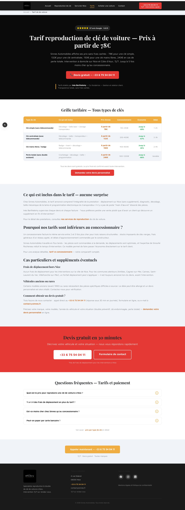</a><br><strong>Tarif clé de voiture — Prix à partir de 78€ Nice | Sinnes Nice</strong><br><a href="docs/captures-pages/tarif-cle-voiture.jpg">Ouvrir la capture complète</a></td><td align="center" valign="top"><a href="docs/captures-pages/urgence-cle-voiture.jpg">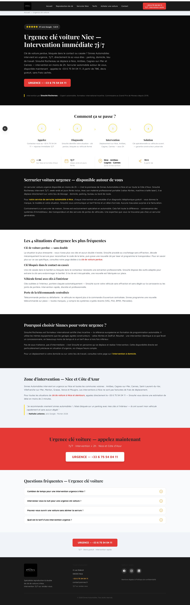</a><br><strong>Urgence clé voiture Nice — Intervention immédiate 7j/7 | Sinnes Nice</strong><br><a href="docs/captures-pages/urgence-cle-voiture.jpg">Ouvrir la capture complète</a></td></tr>
</tbody></table>

## Informations techniques

<details>
<summary>Technologies, vérifications et éléments à reprendre</summary>

**Ce que c’est :** un site vitrine pour une activité de serrurerie automobile à Nice.

**À quoi il sert :** présenter les services et les marques, organiser des pages locales et orienter un visiteur vers une prise de contact.

**Ce qui a été réalisé :** pages de services, contenu local, vidéo d’accueil, navigation responsive et contrôles du build et du parcours navigateur.

**Technologies :** Next.js 16, React 19, TypeScript, rendu statique, Framer Motion et Swiper.

Le contenu métier historique est conservé mais les avis, tarifs, disponibilités et promesses commerciales n’ont pas été revérifiés.

Le design existant est conservé. Les avis, tarifs, disponibilités et promesses commerciales visibles proviennent du contenu historique ; ils n’ont pas été revérifiés ici. Ce n’est ni un système de réservation ni une garantie de positionnement Google.

## Lancer le site

Node.js20.9+ compatible avec Next16 ; Node26.7.0 utilisé pour cette vérification, pas une validation de toutes les versions.

```sh
npm ci --ignore-scripts
npm run build
npm start -- --hostname 127.0.0.1 --port 4187
```

Ouvrir http://127.0.0.1:4187. En développement : `npm run dev`. Aucun nouveau déploiement de production n’est annoncé ici.

## Vérifications

Build et TypeScript réussis,27pages générées dans le build dont les routes techniques. Les17tests Chromium existants passent sur le serveur local : titres, navigation/téléphone, vidéo hero, pages de services et certains textes. L’accueil à390px a une largeur de document390px ; vidéo en lecture et44images chargées. Trois captures réelles : accueil desktop/mobile et service.

```sh
PLAYWRIGHT_BASE_URL=http://127.0.0.1:4187 npx playwright test --project=chromium
```

Le paramètre d’environnement a été ajouté pour éviter de lancer les tests sur le site distant. Sans ce paramètre, la configuration conserve son URL de production historique. Mobile Safari non testé ici ; les tests sont ciblés, pas une validation exhaustive du site.

Le lint échoue avec391erreurs et2avertissements, principalement liens internes HTML et caractères JSX non échappés. Audit npm :17alertes, dont1critique,13élevées,2modérées et1faible. Revoir ces dépendances avant nouveau déploiement ; aucune migration ni correction UI générale effectuée pendant cette préparation.

## Reprise

Corriger le lint, mettre à jour les dépendances avec tests de non-régression, confirmer le contenu métier et les droits des médias, vérifier clavier/mobile et contacts sans envoyer de demandes de test à l’entreprise. Le dépôt distant à `e96244a8c89e220a9c0c1771116b7b26a3cfb0c2` sert de référence ; l’archive Sinnes-demo comprend aussi des notes SEO/mirrors non destinés à être republiés en bloc.

Voir [VERIFICATION.md](VERIFICATION.md).

## Dépôt et téléchargement

[Voir le dépôt](https://github.com/cpointis96-hue/sinnes-nextjs) · [Télécharger les sources ZIP](https://github.com/cpointis96-hue/sinnes-nextjs/archive/HEAD.zip). Le ZIP contient les sources, pas un site hébergé par ce dépôt.

</details>
